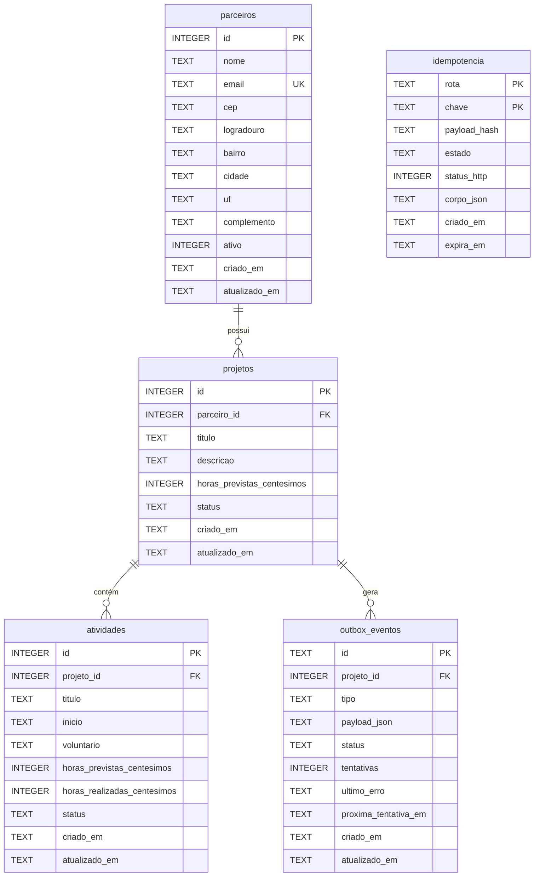

# Plano Técnico

## Organização do código (`src/`)

Vou usar Python 3.12 com FastAPI, `sqlite3`, `httpx` e `pytest`. Dividi em apenas 4 arquivos para não espalhar demais:
- `src/banco.py`: abre a conexão e cria as tabelas no SQLite .
- `src/regras.py`: funções separadas de cálculo (percentual, paginação e hash).
- `src/integracoes.py`: consulta de CEP e envio do webhook com assinatura.
- `src/app.py`: rotas HTTP, validações e respostas de erro.

## Banco de dados (SQLite)

O banco fica salvo em arquivo (`DATABASE_PATH`, usando `/data/conecta.db` no container para não perder dados ao reiniciar). O próprio SQLite garante unicidade de e-mail (`UNIQUE`), bloqueia exclusão de registros com filhos (`FOREIGN KEY ... ON DELETE RESTRICT`) e impede duplicidade de `Idempotency-Key` pela chave composta `(rota, chave)`:

## Variáveis de ambiente

- `DATABASE_PATH`: caminho do banco SQLite (`./conecta.db` local ou `/data/conecta.db` no container).
- `VIACEP_BASE_URL`: URL base da consulta de CEP (padrão `https://viacep.com.br/ws`).
- `HTTP_TIMEOUT_MS`: timeout da ViaCEP em ms (padrão `2000`).
- `WEBHOOK_URL`, `WEBHOOK_SECRET`, `WEBHOOK_TIMEOUT_MS` (padrão `3000`) e `WEBHOOK_MAX_RETRY_AFTER_S` (padrão `60`).

## Ordem de construção

1. Resolver os 4 casos curtos em `debug/` primeiro.
2. Subir `/saude`, banco, formato de erro e CRUD de Parceiros + mock da ViaCEP.
3. Fazer Projetos e o controle de `Idempotency-Key`.
4. Fazer Atividades e o Relatório do projeto.
5. Fazer a publicação do Webhook e retentativas.
6. Montar o `Containerfile` e revisar o `README.md`.

